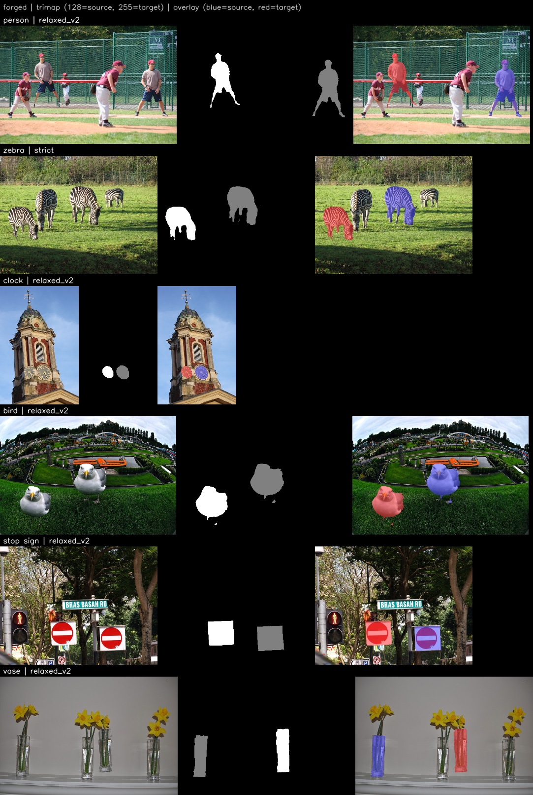

# COCO-CMFD

A synthetic copy-move forgery dataset built from MS-COCO 2017, with
ground truth that distinguishes the **source** region (where an object
was copied from) from the **target** region (where it was pasted).

8,245 forged images, 4,788 distinct source photographs, 63 object
categories, released in four parts by the licence of the source
photographs (release v1.1; see [Licensing](#license-and-attribution)). Every pasted object is placed somewhere the scene actually
supports it rather than at a random offset.

- **Dataset:** https://huggingface.co/datasets/harshitajainn/coco-cmfd
- **DOI:** `TODO — add badge after first GitHub Release`



*Left to right: forged image, trimap (128 = source, 255 = target),
overlay (blue = source, red = pasted copy).*

## Why this dataset exists

The classic benchmarks: CoMoFoD (260 image sets), CASIAv2, COVERAGE (100 images) are usually used for
*evaluation* in DL based CMFD methods. The synthetic corpus most published CMFD models pretrain
on, USC-ISI CMFD (introduced with BusterNet), is no longer reliably
obtainable, which leaves a reproducibility gap.

The usual response is to synthesise forgeries from COCO, and that involves taking an annotated object, pasting it elsewhere, keeping the mask.
The problem that arises is that naive synthesis produces forgeries that are extremely unrealistic. A car floating in the sky, a
mirrored STOP sign reading "POTS", a zebra pasted at three times the
size of the zebra beside it. A detector trained on those learns to find
*impossible scenes*, not duplicated pixels and that shortcut
evaporates on real forgeries, where a human forger placed the copy
somewhere believable.

This dataset attempts to remove that shortcut. Placement is
constrained by what the scene can physically support, so the copy is
plausible and the most reliable remaining signal is the duplication
itself.


## How a sample is generated

Each forgery goes through four stages. An image that fails any check is
skipped and the reason logged so that there is no partial output.

### 1. Choosing what to copy

The source object comes from a COCO instance annotation, refined to a
tighter boundary than the raw polygon (GrabCut, or a precomputed
MobileSAM mask when it agrees with the polygon at IoU ≥ 0.6). It then
has to survive several filters, each of which exists because of a
specific failure seen in visual review:

| Filter | Why |
|---|---|
| Not touching the image edge | Edge objects are truncated by the frame. Pasted mid-image, the flat cut is glaringly artificial. |
| Mask fills ≥ 25% of its bbox | Very sparse masks mean the object is occluded, spindly, or fragmented. |
| Mask fills ≤ 92% of its bbox (organic categories) | The inverse failure — segmentation leaked into the background and grabbed a rectangle of wall. |
| Compactness ≥ 0.15 | Rejects jagged, disconnected remnants left by imperfect segmentation. |
| No contact with other annotations | An object touching another is usually occluded or interlocking — a person *riding* a horse, a hand *holding* a racket. Copying it drags along a piece of something else. |
| Sufficient texture (Laplacian variance) | Flat, textureless regions provide nothing to match on. |

### 2. Transforming it

Scale 0.70–1.45×, rotation ±10°, horizontal flip. The transform is
deliberately mild: at this stage the model should learn what a copy
*is*, and a copy rotated 90° and scaled 4× is a different, harder
problem best introduced later.

Two category-aware exceptions:

- **Never flipped:** signs, clocks, screens, vehicles, books. Mirroring
  produces backwards text and reversed clock faces — an instant tell.
- **Never rotated:** rigid man-made objects that are always plumb in
  real photographs — furniture, appliances, traffic fixtures. A bench
  tilted 8° reads as fake even when nothing else does.

The same affine matrix is applied to the object's mask with
nearest-neighbour interpolation, so ground truth tracks the pixels
exactly.

### 3. Finding somewhere plausible to put it

This is where most of the work is done, and where most candidates die.

Valid destinations are found by cross-correlating the transformed
object mask against a map of allowed pixels — regions not occupied by
the source object, by another object of the same category, or by a
strong foreground object. Candidates then face:

- **Support surface (gravity).** Using COCO-Stuff labels, the pipeline
  looks at what lies *directly beneath the object's footprint* — not
  the dominant label of its bounding box. That distinction matters: a
  toilet standing on a floor in front of a tiled wall has a
  wall-dominated bounding box, so a bbox-based check places it
  at head height. The footprint check requires ground to land on
  ground, water on water.
- **Horizon band.** The destination must sit within a vertical band
  around the source's height, tightened first and relaxed only if
  nothing is found. Ground-dwelling categories are never released from
  the constraint; only genuine airborne ones (birds, kites, planes)
  may be placed freely.
- **Perspective consistency.** Objects lower in frame are nearer and
  should be larger. The applied scale must agree with the depth implied
  by the *final* destination height, not merely an approximate one.
- **Background compatibility.** Hue/saturation histograms and mean
  luminance of the ring around the source and destination must be
  close, so a sunlit object doesn't land in deep shadow.
- **Separation and margins.** The copy must be well clear of the
  original and at least 10 px from any image edge, so the model cannot
  learn "forgeries touch the frame".

### 4. Compositing and ground truth

The object is composited with an **inward-only 2 px feather**: the
alpha ramp lives strictly *inside* the labelled mask. A razor-sharp
cutout is a giveaway , but a feather that bleeds
*outward* would modify pixels the mask calls background — quietly
teaching the model that the boundary is uncertain. Confining the ramp
inward keeps every modified pixel inside the ground truth. Measured
across the release: **IoU 1.0000 between changed pixels and the
labelled target, with zero pixels altered outside any mask.**

Four ground-truth representations are emitted:

| Artifact | Format | Encoding | What it's for |
|---|---|---|---|
| Trimap | PNG, 1-ch | `0` bg, `128` source, `255` target | Source/target discrimination (BusterNet-style dual branch) |
| Binary mask | PNG, 1-ch | `0` / `255` | Standard forgery localisation |
| Patch labels | int8, H/16 × W/16 | `-1` ignore, `0` bg, `1` source, `2` target | Patch-level / contrastive objectives |
| Hard negatives | uint8 | `0` / `1` | The scene's *other* annotated objects — genuine content that must not be flagged |

Patch labels use a strict purity rule: a patch is labelled only if all
256 pixels share one class, otherwise `-1`. A patch containing even one
boundary pixel carries the copy-move edge as a high-frequency feature,
and a contrastive loss will happily exploit that instead of learning
the appearance statistics you want.

The hard-negative mask matters for the same reason. In an image with
four zebras, a model that flags "two similar-looking regions" is right
by accident. These masks mark the real objects it must learn *not* to
call forgeries.

## What's in the release

| | |
|---|---|
| Samples | 8,245 (`by` 2,006 · `by-nc` 1,697 · `by-sa` 1,092 · `by-nc-sa` 3,450) |
| Source images | 4,788 distinct COCO train2017 images (1–8 samples each, mean 1.7) |
| Categories | 63 COCO categories |
| Resolution | native COCO, longer side 400–640 px |
| Image format | PNG, lossless — no JPEG, noise or blur applied |
| Target bounding box | 2.5%–47.6% of image area (median 8.6%) |
| Transforms | scale 0.70–1.45, rotation ±10°, flip on 24.6% |
| Size | 4.4 GB parquet / 6.7 GB WebDataset |

Metadata carries 35 fields per sample — transform parameters, source
category, which placement tier accepted it, texture and background
similarity scores. See [metadata_schema.json](metadata_schema.json).

The table above describes the artifacts as generated. In the parquet
build, hard negatives are carried as `0`/`255` PNGs rather than `0`/`1`
arrays — lossless for a binary mask and about 100× smaller. The
WebDataset build keeps every file byte-identical to the generated form.

### Generation profiles

Strict source filtering yields roughly 2% of attempted images, which is
not enough volume on its own. Rather than loosen the filters globally
and silently mix quality levels, samples are tagged with the strictness
that produced them:

| `gate_profile` | Samples | Source-object gates |
|---|---|---|
| `strict` | 2,956 | edge margin 15 px, isolation 5×5, bbox fill ≥ 0.25, paste ≥ 2% of image |
| `relaxed_v1` | 115 | edge 8 px, isolation 3×3, fill ≥ 0.20 |
| `relaxed_v2` | 5,174 | as `relaxed_v1`, plus paste ≥ 1.2% of image |

**The scene-plausibility gates of stage 3 are identical in all three
profiles.** Only the selectivity about which objects are worth copying
differs. Filter to `gate_profile == "strict"` for the most conservative
subset; use everything for maximum volume.

`source_reused = 1` (2,723 samples) marks a sample whose source object
is also the source of another sample from the same image, pasted
somewhere else. They are legitimate distinct forgeries, but they are
correlated — cap or drop them if that matters to you.

## Verification

Measured on release v1.0 (12,271 samples), of which v1.1 is a subset;
`tools/verify_release.py` re-checks v1.1 directly. Reproducible with the
included tooling:

| Check | Result |
|---|---|
| Mask alignment — changed pixels vs. labelled target, 60 samples | IoU mean 1.0000, min 0.9997; 0 pixels changed outside any mask |
| File integrity | 61,355/61,355 referenced files present; 400 sampled pixel checks pass |
| Post-hoc plausibility audit | 12,190 clean / 81 rejected (0.66%) — see `metadata_clean.csv` |
| v1.1, all 8,245 samples vs. original COCO photographs (`tools/verify_release.py`) | IoU mean 0.9999, min 0.9300; 0 pixels changed outside any mask; every licence matches its part |

The audit re-applies the placement rules to finished samples and flags
support-surface violations, perspective mismatches and segmentation
leaks. An earlier build of this pipeline failed 26% of that audit; the
gates described above are what closed the gap.

```bash
python tools/check_mask_alignment.py output/stage1_full -n 60
python tools/distribution_report.py  output/stage1_full
python tools/contact_sheet.py        output/stage1_full -n 20
python validate_dataset.py           output/stage1_full
python generator/quality_filter.py   output/stage1_full   # writes metadata_clean.csv
```

## Loading

```python
from datasets import load_dataset

ds = load_dataset("harshitajainn/coco-cmfd", "all", split="train")   # or "by", "by-nc", "by-sa", "by-nc-sa"
sample = ds[0]
sample["image"]        # PIL.Image — forged image
sample["trimap"]       # PIL.Image — 0 / 128 / 255
```

See [load_example.py](load_example.py) for patch-label reshaping and
`gate_profile` filtering. WebDataset tar shards are published under
`wds/<part>/` for streaming-heavy pipelines. Load only the parts whose
licence terms suit your use; every row carries its own `license_name`.

**When constructing splits, group by `image_id`.** Multiple samples
share a source photograph, so a naive random split leaks.

## Limitations

- **Synthetic.** These are algorithmic composites, not forgeries made
  by a person trying to deceive someone. Treat this as pretraining data
  and validate on real benchmarks.
- **No post-processing.** Lossless PNG throughout. Real forgeries
  arrive JPEG-compressed, resized and resampled, all of which suppress
  the very artifacts a detector keys on. Robustness to that is *not*
  exercised here. (The pipeline implements a Stage 2 degradation
  profile — JPEG, noise, blur, brightness/contrast — but this release
  does not use it.)
- **Mild transforms.** ±10° and 0.70–1.45×. Large rotations and extreme
  rescaling are out of distribution.
- **One copy-move per image.** No multi-source, nested or chained
  forgeries.
- **COCO's category imbalance**, partially capped: person 7.8%, clock
  7.7%, bird 7.2%.
- **Plausibility is heuristic.** COCO-Stuff labels are coarse and the
  support-surface test is a footprint probe, not depth estimation.
  Roughly 0.7% of samples still fail the post-hoc audit; they are
  flagged in `metadata_clean.csv`.

## Regenerating

Requires MS-COCO 2017 train images plus `instances_train2017.json` and
`stuff_train2017.json` (~19 GB). The generator skips photographs whose
licence forbids adaptations (COCO licence ids 3 and 6), so a fresh run
produces only redistributable samples.

```bash
pip install -r requirements.txt
export COCO_ROOT=/path/to/coco          # expects train2017/ and annotations/
./run_full_generation.sh                # strict profile, 6 shards over all 118k images
./run_overnight_pass.sh                 # relaxed_v2 re-paste + recovery passes
```

Generation is **deterministic** — the RNG is seeded per (image,
variant), so the same seed reproduces the same forgery for a given
image regardless of shard order or where a run resumed. It is also
**resumable**: each sample is appended to `completed.jsonl` as it is
written, completed and failed images are skipped on restart, and
`metadata.csv` is rebuilt from that ledger. The released set used seed `1337`.

Single pass:

```bash
python generator/main.py --stage stage1 --num-images 20000 --seed 1337 \
    --shard 0 --num-shards 6 --output-dir output/stage1_full
```

Paths resolve from `--coco-root`, then `$COCO_ROOT`, then `~/coco`.
Sharding keeps peak memory to a fraction of the annotation set; the
released build ran single-process on 8 GB of WSL2.

## Repository layout

```text
generator/          generation pipeline
  main.py           CLI, sharding, resume ledger, seeding
  generator.py      copy-move engine, plausibility gates
  stage_config.py   profile presets (strict / relaxed_v1 / relaxed_v2 / stage2)
  scene_layout.py   COCO-Stuff surface maps, support-surface checks
  patch_utils.py    patch-grid labelling
  quality_filter.py post-hoc plausibility audit
tools/              quality gates and packaging
validate_dataset.py consumer-side integrity check
run_*.sh            the exact passes used to build the release
samples/            six image/mask pairs + preview grid
```

## Citation
If you use this dataset, cite it as follows
```bibtex
@dataset{jain_coco_cmfd_2026,
  author    = {Jain, Harshita},
  title     = {{COCO-CMFD}: A Synthetic Copy-Move Forgery Dataset
               with Source/Target Ground Truth},
  year      = {2026},
  publisher = {Zenodo},
  doi       = {TODO — add DOI after first GitHub Release},
  url       = {https://github.com/harshitajain523/COCO-Copy-Move-Forgery-Dataset}
}
```

## License and attribution

- **Code** — MIT, see [LICENSE](LICENSE).
- **Dataset** — four parts, each under the licence its source
  photographs allow; see [LICENSE-DATA](LICENSE-DATA) and
  [LICENSING.md](LICENSING.md).

| Part | Source photographs | Licence |
|---|---|---|
| `by` | CC BY 2.0, no known copyright restrictions | CC BY 4.0 |
| `by-nc` | CC BY-NC 2.0 | CC BY-NC 4.0 |
| `by-sa` | CC BY-SA 2.0 | CC BY-SA 4.0 |
| `by-nc-sa` | CC BY-NC-SA 2.0 | CC BY-NC-SA 4.0 |

COCO *annotations* are CC BY 4.0, but COCO *images* are Flickr
photographs that keep their owners' licences. Release v1.0 (12,271
samples, CC BY 4.0) overlooked this; v1.1 removes the 4,026 samples
built from NoDerivs photographs and licenses the rest by source. Every
row carries its photograph's licence and Flickr URL for attribution.
Also credit COCO-Stuff, whose labels drive the placement checks.

On dataset usage, also cite MS-COCO:

```bibtex
@inproceedings{lin2014microsoft,
  title     = {Microsoft {COCO}: Common Objects in Context},
  author    = {Lin, Tsung-Yi and Maire, Michael and Belongie, Serge and
               Hays, James and Perona, Pietro and Ramanan, Deva and
               Doll{\'a}r, Piotr and Zitnick, C Lawrence},
  booktitle = {ECCV},
  year      = {2014}
}
```
